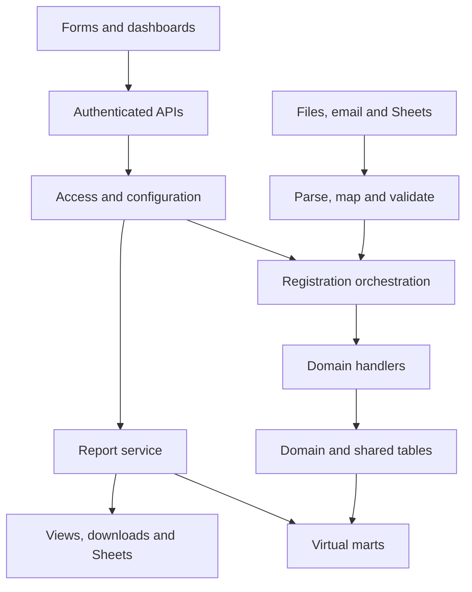

# Developer guide

> Generated from maintained definitions. Do not edit this page directly.
> Governance 0.3.7; naming 0.2.3; application evidence b2b156c44ba7744bf6cb81c19eb3a05d8633fdba.
> Draft catalogue. Approval, implementation, verification and publication are separate.

[Home](README.md) · [Architecture](architecture.md) · [Standards](standards.md) · [Naming](naming.md) · [Features](features.md) · [Design](design.md) · [Implementation](implementation.md) · [Decisions](decisions.md)

Generated developer handoff draft; proposed design, not implemented or published

| Property | Value |
| --- | --- |
| Project | COS_Governance design; EMPRegister implementation baseline |
| Guide version | 0.1.0 |
| Application evidence | b2b156c44ba7744bf6cb81c19eb3a05d8633fdba |
| Template | [18-section structure](../templates/design.yaml) |
| Source and authorization | [Evidence](../discussions/developer-guide-23-Oct-2026.md) |

## 1. Document control

| Area | Developer instruction |
| --- | --- |
| Identity | Developer guide and implementation matrix; derivative generated from maintained definitions. |
| Status | Design draft; requirement recording is separate from code, verification and publication. |
| Source baseline | Existing EMPRegister onboarding controller/contracts/V4 migration read at pinned commit. |
| Owner | COS governance/design owner; implementation owner/assignee not verified. |

## 2. Business objectives

| Area | Developer instruction |
| --- | --- |
| Objective | Replace spreadsheet working with configurable web operations and DB-owned data. |
| Users | Entity owner, group-authorized admin, HR, permitted employees and reporting users. |
| Outcome | Consistent validation, matching, access, confirmations, provenance and virtual-mart reporting. |

## 3. Requirements and features

| Area | Developer instruction |
| --- | --- |
| Scope | Employee domain, reusable controls, proposed vendor/aggregator/source registration, templates and data flow. |
| Canonical requirements | features/common.yaml; do not duplicate editable requirement bodies. |
| Next phase | Gather working-sheet fields/tables and source mappings after this guide. |
| Exclusions | No live uploads, source-sheet edits, application implementation, deployment or issue assignment. |

## 4. Architecture

| Area | Developer instruction |
| --- | --- |
| HRMS hierarchy | Enterprise Management > HRMS > Employee Management > Employee Registration. |
| Other registrations | Vendor, aggregator and source registration are distinct; exact suite/engine/module placement pending. |
| Database connections | Frontend calls authenticated backend; backend/worker uses pooled DB connections. No browser-to-DB credentials. |
| Entity context | Resolve from authenticated membership; map existing scope_id before migration. |
| Deployment | Retain existing frontend/Java/PostgreSQL implementation baseline; provider and production topology pending. |

## 5. Reuse

| Area | Developer instruction |
| --- | --- |
| Reuse | Shared registration orchestration, configuration, access, uniqueness, errors, audit, import and report infrastructure. |
| Domain responsibility | Typed handlers/repositories retain domain meaning and authoritative writes. |
| Existing code | Review OnboardingService/Contracts/controller, drafts, encryption, history and membership before replacing. |
| Avoid duplicates | Reuse equivalent auth/meta/config/audit records; no universal arbitrary-table writer. |

## 6. Functional design

| Area | Developer instruction |
| --- | --- |
| Uniqueness | Entity-admin versioned key of at least two required fields; keyless/ambiguous updates blocked across all sources. |
| Activation | Scan missing values/duplicates, review affected dependencies and confirm activation. |
| Concurrency | Optimistic row versions plus transactional key claims; safe canonical protected token design pending. |
| Mutable key | Locate with old key, validate new combination, confirm, update claims/history atomically. |
| Defaults | Entity/admin defaults then permitted user preference/event selection; actual default keys pending. |

## 7. Frontend

| Area | Developer instruction |
| --- | --- |
| Navigation | Readable Suite/Engine/Module/Component display selection; favorites; subscription/access filtering. |
| Registration GUI | Configured fields, manual/auto ID mode, validation, save/submit permitted action and source error links. |
| Bulk GUI | Excel/CSV/PDF/Google Sheet selection; template/version; header suggestions; mapping confirmation; row preview/results. |
| Report GUI | Authorized mart fields, columns/filters/sorting/grouping; downloads; exact Google Sheet destination and append/clear confirmation. |
| Preference GUI | Apply once or confirm save/change; no silent persistence. |
| States | Loading, empty, validation error, permission failure, stale preview/version, partial job and retry outcomes; detailed screenshots pending. |

## 8. Workflow

| Area | Developer instruction |
| --- | --- |
| Resolve | Authenticate > entity > subscription > group/hierarchy/field scope > effective configuration. |
| Preview | Parse/map > types/required fields > configured unique key > match outcomes > access-safe errors. |
| Confirm | Bind confirmation to reviewed input, mapping, versions, destination, range, filters and write mode. |
| Execute | Recheck permissions/config/row version; transactional domain write, key claim, history and outbox. |
| Finalize | Persist outcomes/source pointers; deliver external operations with idempotent retry. |
| Approval | Preserve domain-specific direct HR edit versus employee update review; do not impose universal admin approval. |

## 9. Database

| Area | Developer instruction |
| --- | --- |
| Data dictionary | Employee and shared table specifications are separate canonical sources; generated table pages show columns/types/keys/requiredness/validation/upload policy. |
| Relationships | Immutable IDs, same-scope FKs; generated employee ER diagram; polymorphic master/source references need registered adapter checks. |
| Migration | Reviewed forward migration from people/encrypted aggregates; retain IDs/history/keys/encryption contexts and compare reconciled results. |
| Readiness | Physical types, constraints/indexes, tenant identity model and complete working-sheet columns are not finalized. |

## 10. API and DTO

| Area | Developer instruction |
| --- | --- |
| Contracts | Resource APIs with typed domain DTOs and shared command/error envelopes; API matrix below is proposed. |
| Compatibility | Current /api/v1/cos/onboarding routes and snake_case contracts remain until reviewed migration. |
| Errors | Stable code plus configured message, permitted record ID, request/run and source row/page/message reference. |
| Safety | Internal target ID alone cannot bypass configured complete matching key; no arbitrary SQL or dynamic table path in payload. |

## 11. Code design

| Area | Developer instruction |
| --- | --- |
| Naming | Resolve classes/files/functions/DTOs through current naming source; no mandatory COS prefix everywhere. |
| Project | Implementation baseline EMPRegister; Java apps/api and frontend apps/web roots. Proposed new files are not existing code. |
| Layers | Controller transport; service orchestration; handler domain rules; repo persistence; adapters external services. |
| Matrix | Architecture/feature -> screen/API/DTO -> service/handler/function/repo -> table/mart/connection -> permission -> test. |

## 12. Configuration and history

| Area | Developer instruction |
| --- | --- |
| Versions | Configuration, field definitions, rule selection, mappings and templates are versioned. |
| History | Separate config, field-definition, business data and security audit; sensitive prior values protected. |
| Preferences | Confirm every save/change; one-event settings do not replace saved preferences. |
| Preview validity | Invalidate or re-preview material input, permission, config, key, mapping or destination changes. |

## 13. Security

| Area | Developer instruction |
| --- | --- |
| Permissions | Subscription AND entity/group/hierarchy/field/record access for all input/output paths. |
| Groups | Owner within entity/subscription; admin via admin group; conflict/inheritance/future-child rules pending. |
| Secrets | Separate runtime/migration credentials; use deployment secrets and protected connection references. |
| Data | Protect identity, bank, source and history values; errors/search/export cannot leak inaccessible fields. |
| Database | Parameterized queries, scoped FKs, explicit transactions; DB security design must reinforce application checks. |

## 14. Integration

| Area | Developer instruction |
| --- | --- |
| Input adapters | Files, Google Sheets and email feed common parse/map/validate/execute pipeline. |
| Source registration | Business vendor/aggregator is separate from data source; multiple sources may relate to one business platform. |
| Sheet output | Every execution confirms append or exact clear-and-write range; system remains owner. |
| Idempotency | Track request/job/source identities; retries must not repeat business writes or blindly append duplicate output. |
| Storage | Use approved private source storage with DB provenance; no credentials/live upload records in GitHub. |

## 15. Masters and reporting

| Area | Developer instruction |
| --- | --- |
| All reporting | Database > governed virtual mart > report service > dashboard/download/Google Sheet output. |
| Dataset | Register grain, fields, joins, measures, filters, ownership and effective definition version. |
| Security | Reapply access to columns, rows, aggregates and outputs; views alone are insufficient. |
| History | Report finalized payroll against immutable approved domain results; virtual mart is not a second editable master. |
| Performance | Indexes/query limits/plan checks based on workload; materialization is a separate explicit design decision. |

## 16. Operations

| Area | Developer instruction |
| --- | --- |
| Operations | Log scoped request/run IDs and durations; monitor failures without secret values. |
| Recovery | Artifact-specific backup/restore and encryption-key recovery; Git history is not DB backup. |
| Rollout | Dry-run migrations/imports, reconcile counts/keys/history, then explicitly approve cutover. |
| Limits | Batch sizes, retry schedule, retention, storage provider/folders and all-or-nothing versus per-row policy pending. |

## 17. Verification

| Area | Developer instruction |
| --- | --- |
| Planned tests | Test matrix below; test cases are not executed evidence. |
| Layers | Unit tests for rule resolution; real PostgreSQL integration tests for transactions/FKs; API and browser full-flow tests. |
| Acceptance | Each issue links requirements, design commit, tests, results and defects. |
| Verification scope | Governance CI checks source consistency/generation only; no application production readiness claim. |

## 18. Decisions and summary

| Area | Developer instruction |
| --- | --- |
| Pending | Number meaning; actual default keys; identity scope; access conflict/inheritance; full working-sheet mappings; physical schema; shared owners. |
| Next | Read working sheets without source modification, inventory every field/table/source, review gaps then refine templates and schema. |
| Handoff | Use design review then application issues/branches/PRs; Ritesh username and access not resolved, no assignment performed. |
| Change control | New design/implementation scope requires explicit GitHub update authorization; no merge/publication by this draft. |

## Architecture block diagram

## Developer handoff

[Implementation matrix](developer-matrix.md) · [Table formats](table-formats.md) · [Virtual marts](virtual-marts.md) · [Uploads and storage](upload-templates.md) · [Test plan](test-plan.md)

| Task | Deliverable | Dependency | Assignment |
| --- | --- | --- | --- |
| Implementation assessment | Current onboarding/API/schema/encryption/test inventory and gap matrix | Before replacement | Not assigned |
| DB and migration | Reviewed dictionary, keys/FKs/indexes, compatibility and reconciliation tests | Identity/scope decisions | Not assigned |
| Configuration and matching | Versioned entity rules, active composite keys and concurrency | DB/access foundation | Not assigned |
| Access and subscription | Groups, hierarchy/fields, entitlements and denial tests | Conflict/inheritance decisions | Not assigned |
| Registration/details | Frontend/domain handlers/APIs/DTOs and lifecycle history | Config/matching/access | Not assigned |
| Imports and sources | Profiles/templates/row staging/mapping/email/Sheets adapters | Working-sheet extraction and source permissions | Not assigned |
| Virtual marts and reporting | Registered grain/views, filters/export/sync with authorization tests | Domain schema and report requirements | Not assigned |
| Full-flow verification | Automated tests, actual evidence, defects and cutover recommendation | Implemented scope | Not assigned |

No GitHub Issue or developer assignment is created by this table. Exact Ritesh username and assignment authorization remain unresolved.
