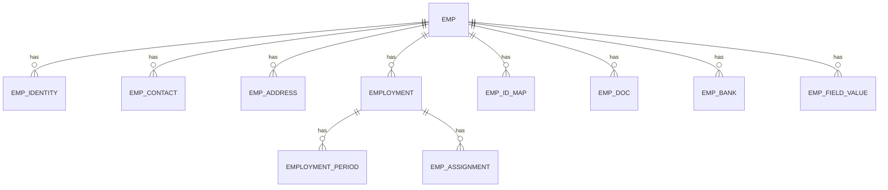

# Employee Management logical database design

> Generated from maintained definitions. Do not edit this page directly.
> Governance 0.3.3; naming 0.2.1; application evidence b2b156c44ba7744bf6cb81c19eb3a05d8633fdba.
> Draft catalogue. Approval, implementation, verification and publication are separate.

[Home](README.md) · [Architecture](architecture.md) · [Standards](standards.md) · [Naming](naming.md) · [Features](features.md) · [Design](design.md) · [Implementation](implementation.md) · [Decisions](decisions.md)

Proposed logical Employee Management data design; no DDL or migration performed

| Property | Value |
| --- | --- |
| Target schema | emp |
| Current schema | people at pinned implementation baseline; reviewed migration pending |
| Common controls | [Shared requirements](common-requirements.md) |

## Principles

- Stable internal IDs for relationships; sys_emp_id is the business identifier.
- Employee Master is a generated view/report with no RPT suffix, not a duplicate editable master.
- Active entity-admin uniqueness configuration supersedes the older fixed employee identity combination; minimum two selected fields.
- Physical database constraints should enforce applicable configured uniqueness and concurrent-write safety; detailed implementation remains pending.
- Salary, attendance and leave remain in owning modules; application identity/access records remain shared.
- Typed custom responses reference field-definition versions. Protect identity/bank values and sensitive history.

| Proposed table | Purpose | Indicative fields | Status |
| --- | --- | --- | --- |
| emp.emp | Stable employee identity | id; sys_emp_id; name; father_name; nationality reference | Proposed logical table and indicative fields; not deployed |
| emp.emp_identity | National identity details | emp_id; identity type; protected number; protected matching token; verification status | Proposed logical table and indicative fields; not deployed |
| emp.emp_contact | Contact details | emp_id; contact type/value; primary flag; verification status | Proposed logical table and indicative fields; not deployed |
| emp.emp_address | Addresses | emp_id; address type; address fields; effective dates | Proposed logical table and indicative fields; not deployed |
| emp.employment | Employment relationship | emp_id; organization reference; employment type; current status | Proposed logical table and indicative fields; not deployed |
| emp.employment_period | Joining, exit and rejoining | employment_id; joining date; exit date/reason | Proposed logical table and indicative fields; not deployed |
| emp.emp_assignment | Department, role, group and location assignments | employment_id; assignment type; owning master reference; effective dates | Proposed logical table and indicative fields; not deployed |
| emp.emp_id_map | External system IDs | emp_id; source system; external ID; effective dates | Proposed logical table and indicative fields; not deployed |
| emp.emp_doc | Employee links to shared document storage | emp_id; document type; document reference; verification status | Proposed logical table and indicative fields; not deployed |
| emp.emp_bank | Payment account details | emp_id; protected account details; verification status; effective dates | Proposed logical table and indicative fields; not deployed |
| emp.emp_field_value | Configured custom field responses | emp_id; field-definition reference; typed value; configuration version | Proposed logical table and indicative fields; not deployed |

## Relationships

## Shared logical records

- Field definition and entity field configuration
- Versioned uniqueness rules and key fields
- Form configuration
- Access group, hierarchy/field permission and user-group assignment
- Entity subscription/entitlement
- Source-to-field mapping and suggested match decisions
- Import/export/sync execution and row outcomes
- Google Sheet authorized connection/profile
- Email extraction profile and processed-source references
- Report definition, dataset, dashboard and saved views
- User preferences and confirmation history
- Configuration/field/data/audit history
- Requests and approval decisions
- Shared document metadata and integration events

## Pending design work

- Logical table names and fields need physical schema review.
- Scope of sys_emp_id and internal identity versus organization/tenant needs confirmation.
- Migration from existing encrypted profile aggregates must preserve data, history and encryption compatibility.
- Detailed DB APIs, DTOs, types, indexes and acceptance tests remain pending.

[Canonical logical design](../architecture/emp-data-design.yaml) · [Evidence](../discussions/common-requirements-23-Oct-2026.md)
