# System design

> Generated from maintained definitions. Do not edit this page directly.
> Governance 0.3.8; naming 0.2.3; application evidence b2b156c44ba7744bf6cb81c19eb3a05d8633fdba.
> Draft catalogue. Approval, implementation, verification and publication are separate.

[Home](README.md) · [Relational tree](tree.md) · [Architecture](architecture.md) · [Standards](standards.md) · [Naming](naming.md) · [Features](features.md) · [Design](design.md) · [Implementation](implementation.md) · [Decisions](decisions.md)

| Property | Value |
| --- | --- |
| Reference | SYS-DESIGN-01 |
| Version | 0.2.0 |
| Stage | Draft |
| Approval | Pending |
| Implementation | Partially reflected by the EMPRegister baseline for Employee Management only; COS-wide runtime not implemented |
| Verification | Source inspection of the pinned application baseline only; no load, security or deployment test executed |
| Publication | Unpublished |

Runtime system design for the whole CulinaOS platform as a metadata-driven system: COS Core plus plug-in engines, the metadata model and its layering, versioning and promotion, the runtime command and query pipelines, data storage, workflow, UI rendering, events, security, the admin studio, technology stack, tenancy, deployment, non-functional targets and diagrams. Business hierarchy stays in architecture/objects.yaml; logical tables stay in the data-design files.

**Not affected:** Does not approve any Pending standard, rule, shortcode or decision. Does not adopt the Technology Stack Standard; stack rows marked Proposed need explicit approval. No application code, schema, deployment, cloud account or connector is created or changed. Candidate non-functional targets are proposals until the business confirms them.

## Context

CulinaOS (COS) is a metadata-driven operating platform for a multi-brand restaurant and cloud-kitchen business (initial company: MHL). One platform hosts 9 suites / 47 engines; each engine is delivered as configuration over shared runtime services plus a small amount of domain code.

| Actor | Role |
| --- | --- |
| Platform administrator | Manages tenants, entitlements, platform configuration and releases |
| Entity administrator | Configures fields, forms, uniqueness keys, access groups and imports for a company/brand/outlet |
| Operational user | HR, finance, purchase, kitchen and outlet staff using generated screens |
| Reviewer / approver | Approves operation-specific changes per the authority matrix |
| Developer | Builds domain handlers and shared services from Published baselines |
| AI assistant | Reads governed definitions; never writes without explicit confirmation (GITHUB-CONFIRM-01, AI-CREATE-CONFIRM-01) |

| External system | Use | State |
| --- | --- | --- |
| Petpooja | POS sales, raw materials, recipes, operational inventory | API scope UNVERIFIED |
| Zoho Books | Invoice scanning, bills, vendor payables, accounting masters, journals | Organisation configuration pending |
| Razorpay | Payments, settlements, payouts and/or payroll | Exact product and scope pending |
| Attendo | Attendance source | API entitlement unverified |
| Aggregators (Ownly and others) | Payout and order files | File-based; Ownly rules drafted |
| Google Workspace | Sheets input/output, Drive files, Gmail extraction, optional SSO | Sheets sync not implemented |
| GitHub | Governance definitions, code, CI | Live operational data excluded |

## Architecture style

Metadata-driven modular monolith: one COS Core that every engine plugs into, and business engines delivered as plug-in packages (manifest + metadata + schema + handlers + UI). One backend codebase and deployable, internally divided by engine with enforced boundaries.

- Build the COS Core and the first engine (HRMS / Employee Management) together: each shared service is built the first time a real module needs it, behind a contract, and a second engine proves it is reusable.
- Small team (four named working users) cannot operate 47 independently deployed services.
- Shared services (config, uniqueness, access, import, report, audit) are used by every engine and need one transaction boundary with domain writes (DRAFT-BE-R06).
- Module boundaries keep a later extraction possible for a suite that proves different scale, release cadence or ownership.

### Module rules

- One Java module/package root per engine; shared services live in a platform module and never depend on domain modules.
- Engines call each other only through published module APIs or outbox events, never through another engine's tables.
- Each engine owns its database schema; cross-engine reads use APIs, events or governed virtual marts.
- Boundary rules are checked in CI (module dependency tests) once the code structure is approved.

Extract a module into its own service only with a recorded decision showing independent scaling, isolation, compliance or team-ownership need.

| Alternative | Outcome |
| --- | --- |
| Microservices per engine | Rejected for now: operational cost and distributed transactions outweigh benefits at current scale |
| Low-code platform / spreadsheet-only | Rejected: cannot meet uniqueness, audit, permission and integration guarantees already approved |
| Fully generic EAV data model | Rejected: core entities need real typed tables; JSONB only for configurable extra fields |

## Metadata-driven platform

Contents: [COS Core and plug-in engines](#cos-core-and-plug-in-engines) · [Engine manifest standard](#engine-manifest-standard) · [Metadata model](#metadata-model) · [Field type catalogue](#field-type-catalogue) · [Metadata layering and resolution](#metadata-layering-and-resolution) · [Metadata storage and versioning](#metadata-storage-and-versioning) · [Metadata lifecycle and promotion](#metadata-lifecycle-and-promotion) · [Runtime command pipeline](#runtime-command-pipeline) · [Generic API](#generic-api) · [Query engine](#query-engine) · [Data storage patterns](#data-storage-patterns) · [Workflow and approvals](#workflow-and-approvals) · [UI rendering](#ui-rendering) · [Events and integration](#events-and-integration) · [Security model](#security-model) · [COS Studio (administration)](#cos-studio-administration) · [What metadata can and cannot do](#what-metadata-can-and-cannot-do) · [Caching and performance](#caching-and-performance) · [Build order](#build-order) · [Architecture decisions to record](#architecture-decisions-to-record)

## COS Core and plug-in engines

COS is a small core that knows nothing about employees, vendors or journals, plus engines that plug into it. The core runs metadata; engines supply metadata and the code metadata cannot express. The plug-in unit is an engine; its modules and components are registered inside its package.

**Which suites are core and which plug in**

| Layer | Suites | Built how |
| --- | --- | --- |
| COS Core | Technology & Platform Services, Platform Governance, Integration, Common Data | Built once as platform services; only the slices a real engine needs, when it needs them |
| Plug-in engines | Enterprise Management (HRMS, Finance, ...), Product & Commercial, Supply & Operations, Sales & Customer | One package per engine; mostly metadata plus a few domain handlers |
| Consumers | AI & Analytics | Plug-in engines that read governed virtual marts and events; never other engines' tables |

**Engine lifecycle**

| State | Meaning | Who moves it |
| --- | --- | --- |
| Available | Package is in the release but not installed in this environment | Release pipeline |
| Installed | Schema migrated, product metadata loaded, handlers registered; visible to nobody | Deployment step |
| Enabled | Turned on for an entity through an entitlement with effective dates | Platform administrator |
| Upgrading | New package version migrating schema and metadata; old version still serving | Deployment step |
| Disabled | Entitlement ended for an entity; data kept read-only per retention policy | Platform administrator |
| Retired | Removed from the release after data disposition is approved | Explicit decision |

- An engine depends on the core SDK only; it never imports another engine's code or reads another engine's tables.
- Engines talk through published APIs and outbox events (for example Finance listens for hrms.employment.exited to start final settlement).
- Nothing enters the core until a module needs it; anything specific to one domain stays in that engine.
- A second engine (Finance: Ownly sales-to-journal, or Vendor master) is the test of the core: if it needs core changes, fix the contract, not the module.

### COS Core with plug-in engines

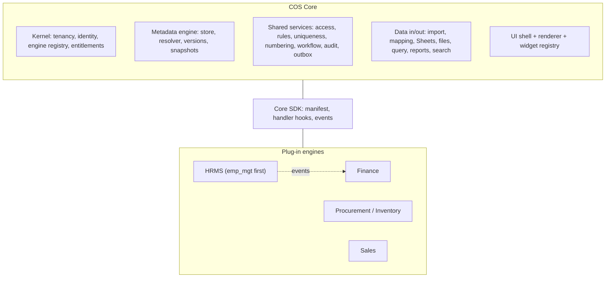

### Engine lifecycle

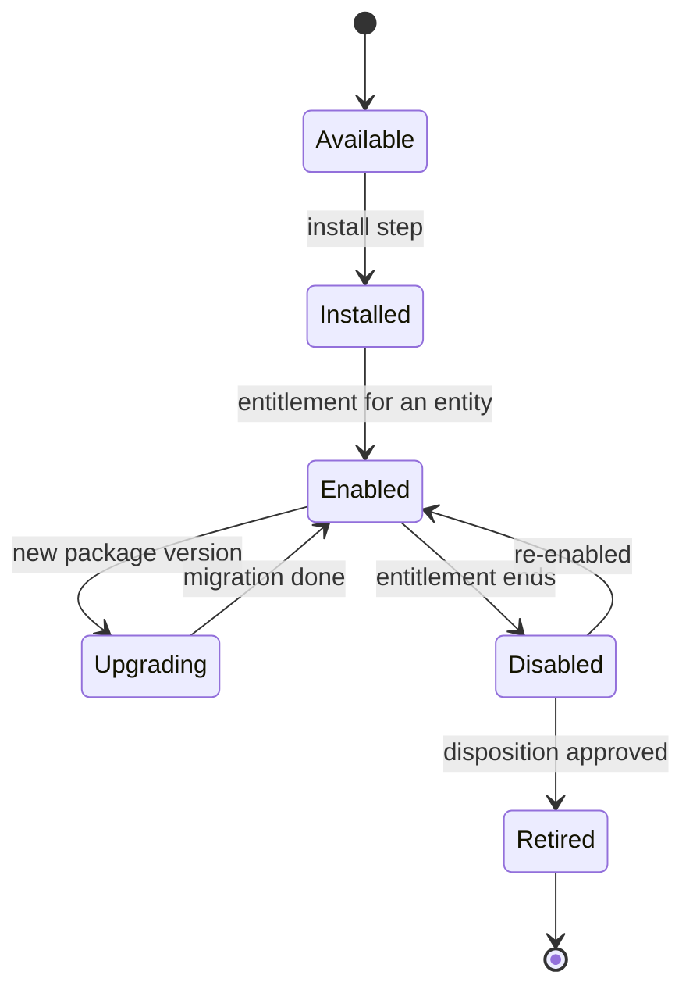


## Engine manifest standard

Every engine declares itself in one manifest. At start-up the core reads all manifests, checks dependencies, runs the engine's migrations, loads its product metadata, and registers its handlers, routes, menus and event subscriptions.

| Key | Required | Meaning |
| --- | --- | --- |
| engine | Yes | Engine code from architecture/objects.yaml (for example hrms) |
| suite | Yes | Parent suite short code (for example COS-EMS) |
| version | Yes | Semantic version of the package |
| requires | Yes | Minimum core version and any engine APIs it calls |
| modules | Yes | Modules and their components (short codes) the package registers |
| schema | Yes | The database schema the engine owns, with its Flyway migration folder |
| metadata | Yes | Folders of product metadata: objects, forms, views, rules, workflows, permissions, menus, reports, import profiles, events |
| handlers | No | Java classes implementing core SDK interfaces for logic metadata cannot express |
| events | No | Events published and subscribed |
| ui | No | Routes, menu entries and any custom widgets or pages |
| entitlements | Yes | Which modules can be enabled separately for an entity |

- Component short codes other than emp_reg are placeholders until the pending shortcode allocation is approved.

```yaml
engine: hrms
suite: COS-EMS
version: 1.0.0
requires: { core: ">=1.0", engines: [] }
modules:
  - code: emp_mgt
    components: [emp_reg, emp_dtl, emp_lifecycle, emp_assign, emp_doc]
schema: { name: emp, migrations: db/migration/emp }
metadata: [objects/, forms/, views/, rules/, workflows/, permissions/, menus/, reports/, import-profiles/]
handlers: [EmpRegistrationHandler, EmploymentLifecycleHandler]
events:
  publishes: [hrms.employee.registered, hrms.employment.exited]
  subscribes: []
ui:
  routes: [/hrms/employees, /hrms/employees/new, /hrms/employees/:id]
entitlements: [emp_mgt]
```


## Metadata model

Twenty metadata types describe what an engine is and how it behaves. Each type has a JSON Schema, a version, an owner layer, and one core service that interprets it.

| Type | Defines | Key properties | Interpreted by |
| --- | --- | --- | --- |
| Object | A business record type (Employee, Vendor, Journal) | code, engine, storage table, business ID field, scope rule, lifecycle workflow | Core runtime |
| Field | One attribute of an object | code, type, label, help, required, default, read-only, sensitive, allowed values, depends-on | ConfigService |
| Relation | A link between objects | from, to, cardinality, same-engine FK or cross-engine reference, delete behaviour | Core runtime |
| Form | Layout for create and edit | sections, field order, columns, conditional visibility, repeating groups | UI renderer, ConfigService |
| View | A list, grid or detail layout | columns, default filters, sort, grouping, row actions | QueryService, UI renderer |
| Rule | Validation, derivation or visibility | expression, when it runs, error template, severity | RuleService |
| Unique key | Composite duplicate-check key | fields (two or more), normalisation, blank handling, effective version | UniqueKeyService |
| Numbering | Business ID generation | pattern, sequence scope, manual or auto mode | NumberingService |
| Workflow | States, transitions and approvals | states, transitions, guards, approver rule, SLA, actions | WorkflowService |
| Permission | What an access group may do | level (suite to field), read or write, actions, record scope | AccessService |
| Menu | Navigation entries | label, route, icon, order, required permission | UI shell |
| Import profile | How a source file or sheet is read | file type, sheet, header row, field types, date formats, row classification | ImportService |
| Mapping | Source-to-system field mapping | source header, target field, transform, confirmation state | MappingService |
| Mart | A governed reporting dataset | view name, grain, inputs, allowed columns and filters | MartService |
| Report | A report or dashboard over a mart | columns, filters, grouping, calculations, output formats | ReportService |
| Event | A business event an engine publishes | name, version, payload schema, retention | EventService |
| Notification template | A message sent on an event | channel, recipients rule, template, placeholders | NotificationService |
| Error template | A user-facing error message | stable code, template, allowed placeholders | ErrorService |
| Connector profile | An external system connection | provider, approved connection reference, endpoints, schedule | IntegrationService |
| Preference | A saved user or entity choice | owner, subject, values, confirmation record | PreferenceService |


## Field type catalogue

Fields can only use reviewed types. Each type fixes its storage, its validation and its UI widget, so a new field never needs new code.

| Type | Stored as | Validation | Widget |
| --- | --- | --- | --- |
| text | text | length, pattern | text input |
| long_text | text | length | text area |
| integer | bigint | min, max | number input |
| decimal | numeric(p,s) | min, max, scale | number input |
| money | numeric(18,2) + currency | min, max, currency | money input |
| date | date | range, not future/past | date picker (DD-MMM-YYYY) |
| datetime | timestamptz | range | date-time picker (IST display) |
| boolean | boolean | none | checkbox or switch |
| choice | text code from a value list | allowed values | select or radio |
| multi_choice | text[] of codes | allowed values, max count | multi-select |
| reference | uuid of a record + object code | target exists and is in scope | lookup |
| identifier | encrypted value + HMAC fingerprint | format per identifier kind | masked input |
| phone | text, E.164 | phone format | phone input |
| email | text | email format | email input |
| document | file reference + metadata | type, size, dimensions | upload |
| repeating_group | child rows | min, max rows | repeatable section |
| computed | not stored, or stored by handler | read-only | read-only display |


## Metadata layering and resolution

Configuration comes from five layers. Each later layer may only narrow or customise within what earlier layers allow, never widen access or unlock a locked field. Resolution produces one immutable snapshot per entity, object and version.

| Order | Layer | Authored where | May change |
| --- | --- | --- | --- |
| 1 | Platform (core) | Core code and core metadata in git | Field types, platform-locked identity and security fields, global rules |
| 2 | Engine product | Engine package metadata in git | Objects, core fields, default forms, views, workflows, permissions |
| 3 | Entity configuration | COS Studio, stored in the database | Company fields, labels, required/optional, order, unique keys, numbering, access groups |
| 4 | User preference | Saved by the user with confirmation | Columns, filters, sort, defaults within their permissions |
| 5 | One-event choice | Selected for a single run | Temporary selections; recorded with the run, not saved |

- Resolution order matches the approved common requirement: COS rules, then entity configuration, then user preferences, then one-event selections.
- Every resolved snapshot has a hash; transactions, drafts and import runs store the snapshot they used.
- Locked items (identity, scope, security, relationship keys) cannot be overridden by layers 3 to 5.

### Metadata layers resolve into one snapshot

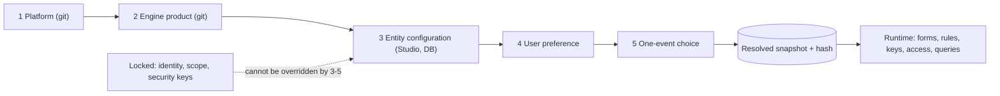


## Metadata storage and versioning

All metadata shares one versioning envelope in a meta schema. The proposed config, auth, integration and report tables stay as the typed stores each service queries; the envelope adds package, version, layer and activation.

| Table | Holds |
| --- | --- |
| meta.package | Installed engine packages and versions |
| meta.definition | One row per metadata item: type, code, engine, owner layer |
| meta.definition_version | Immutable versions: JSON body validated by the type's JSON Schema, hash, author, created time |
| meta.activation | Which version is active for which entity scope, with effective dates and approval reference |
| meta.snapshot | Resolved configuration per entity, object and version set, with hash; the cache source |
| config.* / auth.* / integration.* / report.* | Typed projections each service queries (field_def, unique_rule, access_group, import profile, mart_def ...), keyed to the definition version |

- Active versions are immutable; a change creates a new version. Rollback re-activates an earlier version.
- Records keep the snapshot hash they were written with, so old records stay readable after fields change.
- Disabling a field hides it from new input; it never deletes stored values.

### Metadata storage

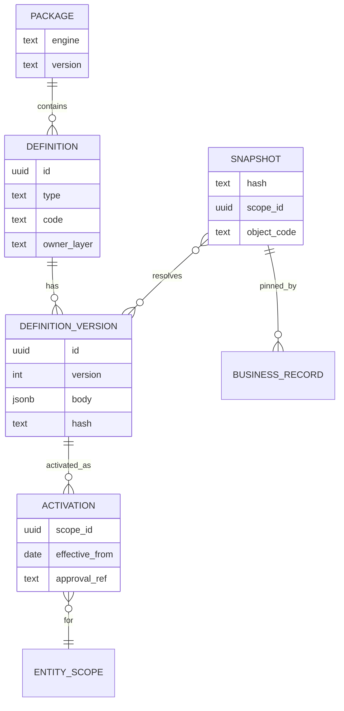


## Metadata lifecycle and promotion

Two paths change metadata. Product metadata ships with code through git and CI. Entity configuration is changed in COS Studio by administrators and goes through draft, preview, impact check and approval.

| Path | Steps | Guard |
| --- | --- | --- |
| Product (layers 1-2) | Edit metadata files in the engine package, pull request, CI validates schemas and references, release, install step loads new versions | Code review, CI, explicit release approval |
| Entity configuration (layer 3) | Draft in Studio, validate, preview the generated form or import, impact check on existing records, submit, administrator approves, activate | Authority matrix; minimum two-field keys; collision scan before activation |
| Between environments | Export entity configuration as a signed package, review the diff, import into staging then production | Same approval as a configuration change |

- COS_Governance stays the source for definitions and standards; engine product metadata lives in the application repository and is generated into the catalogue, not copied by hand.
- No configuration change rewrites history or migrates data silently; changes needing new columns or algorithms go through code review and Flyway.

### Two paths for changing metadata

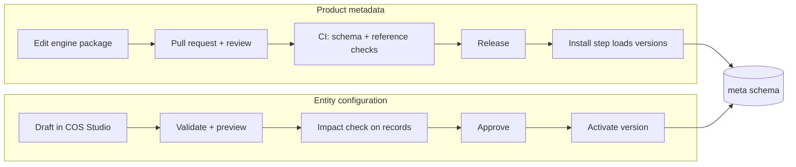


## Runtime command pipeline

Every write, from screen, API, import or Sheet sync, runs the same pipeline. Domain handlers plug into fixed hook points; they never bypass access, validation, uniqueness or audit.

| Stage | Done by | Fails with |
| --- | --- | --- |
| 1. Authenticate | Security filter | 401 |
| 2. Resolve entity scope and principal | Core runtime | 403 when the entity is not permitted |
| 3. Check entitlement | SubscriptionService | 403 capability not subscribed |
| 4. Load pinned config snapshot | ConfigService | 409 when the client's config version is stale |
| 5. Authorise object, action and fields | AccessService | 403 with no detail of protected fields |
| 6. Validate types and rules | RuleService | 422 with field-level error codes |
| 7. Duplicate check and key claim | UniqueKeyService | 409 duplicate with masked match reference |
| 8. Domain handler: beforeSave | Engine handler | 422 domain rule |
| 9. Persist record, history, audit, outbox in one transaction | Repository + core | 409 on optimistic-lock conflict |
| 10. Domain handler: afterCommit | Engine handler via outbox | Retried; never undoes the commit |
| 11. Respond with masked view | Core runtime | - |

### Command pipeline for any write

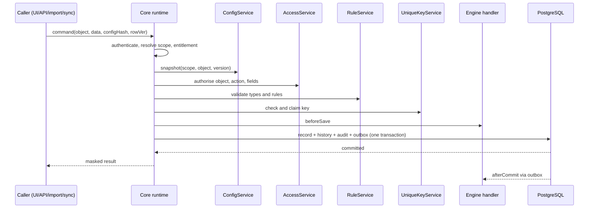


## Generic API

Most endpoints are generic and driven by metadata; an engine adds custom endpoints only for operations metadata cannot express.

| Method and path | Purpose |
| --- | --- |
| GET /api/v1/{engine}/{object} | List and search using a view, filters, sort and keyset paging |
| GET /api/v1/{engine}/{object}/{id} | Read one record, masked by field permissions |
| POST /api/v1/{engine}/{object} | Create through the command pipeline |
| PATCH /api/v1/{engine}/{object}/{id} | Update with row version and config version |
| GET /api/v1/{engine}/{object}/{id}/history | Field and record history |
| POST /api/v1/{engine}/{object}/{id}/actions/{action} | Workflow transition or registered action |
| GET /api/v1/_meta/menus | Navigation for this user and entity |
| GET /api/v1/_meta/{engine}/{object}/form | Resolved form metadata for rendering |
| GET /api/v1/_meta/{engine}/{object}/view/{view} | Resolved list or detail metadata |
| POST /api/v1/imports, /reports/{id}/exports, /sheet-syncs | Shared data-in and data-out services |
| /api/v1/{engine}/x/... | Engine-specific custom endpoints |

- The existing /api/v1/emp routes in the developer guide map onto the generic pattern as /api/v1/hrms/employee; old paths are redirected, not silently removed.


## Query engine

Lists, search, reports and exports go through one QueryService that compiles view metadata into parameterised SQL. Users and metadata never supply raw SQL.

- Only columns registered in metadata or a governed mart can be selected, filtered or sorted.
- Scope predicates (entity, hierarchy, record rules) are always added by the service, never by the caller.
- Field permissions are applied twice: columns are dropped from the query and values are masked in the result.
- Filters use a fixed operator set (equals, in, range, contains, is blank); keyset paging with a configured page-size limit.
- Reports read virtual marts, not engine tables (VIRTUAL-MART-01); heavy marts may be materialised and refreshed by the worker.


## Data storage patterns

Metadata drives behaviour, but data stays in real typed tables so it remains correct, fast and reportable.

| Data | Pattern |
| --- | --- |
| Engine core fields | Typed columns in the engine's schema, created by Flyway migrations declared in the manifest |
| Entity-added company fields | Typed value table per object (for example emp.emp_field_value) keyed by field-definition version; JSONB with generated indexes is the alternative (SD-P11) |
| Identifiers and secrets | Encrypted value plus scoped HMAC fingerprint for matching; masked on read |
| Relations | Foreign keys inside one engine; cross-engine links store a typed reference checked through the owning engine's API |
| History | Per-object history rows plus audit.change_event, written in the same transaction |
| Time-varying facts | Effective-dated rows (from, to) such as assignments and employment periods |
| Identity | UUID primary key, business number from NumberingService, scope_id on every row, composite (scope_id, id) keys |
| Deletion | Status changes and retention policy; no hard delete of business records |


## Workflow and approvals

Status changes and approvals are metadata: states, transitions, guards and approver rules. The WorkflowService runs them through the command pipeline so every transition is checked, audited and published as an event.

- Each object may reference one workflow; transitions are exposed as actions (/actions/{action}).
- Approver rules use the operation-specific authority matrix (DRAFT-BE-R07): for example HR approves employee changes, an administrator approves configuration.
- Guards are declarative rules; anything needing calculation is a handler hook.
- Long-running multi-party flows are the trigger to evaluate an external workflow engine; until then the built-in state machine is enough.

### Employee status workflow (example metadata)

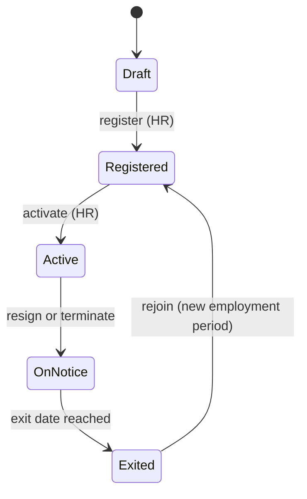


## UI rendering

The web app is a shell plus a renderer. Most screens are generated from metadata; engines add custom pages only where a generic page cannot do the job.

| Page template | Driven by | Example |
| --- | --- | --- |
| List | View metadata | Employee directory |
| Form | Form metadata + rules | Register employee |
| Detail | View metadata + related objects | Employee profile tabs |
| Wizard | Import profile + mapping | Bulk import |
| Dashboard | Report metadata over marts | HR headcount dashboard |
| Custom | Engine-registered page | Payroll review |

- Navigation = menus from installed engines, intersected with the entity's entitlements and the user's access.
- Each field type maps to one widget in a widget registry; engines may register extra widgets in their manifest.
- The same JSON Schema validates in the browser and on the server; the server stays authoritative.
- Labels, help text and error messages come from metadata, so an entity can rename a label without a code change.


## Events and integration

Engines and external systems are connected by events written to the outbox in the same transaction as the change, then delivered by the worker at least once to idempotent consumers.

| Envelope field | Meaning |
| --- | --- |
| event_id | Unique ID used for deduplication |
| type | <engine>.<object>.<verb>, for example hrms.employee.registered |
| version | Payload schema version |
| scope_id | Entity the event belongs to |
| occurred_at, actor | When and who |
| config_hash | Configuration snapshot used |
| payload | Only fields the event schema declares; sensitive values excluded |

- Delivery starts in-process from the outbox table; a message broker is added only after measured need.
- External connectors (Petpooja, Zoho Books, Razorpay, Attendo, Google) are plug-ins configured by connector profiles and approved connection references.


## Security model

An operation is allowed only when every layer allows it. Frontend hiding is convenience; the backend checks every channel: screens, API, search, reports, exports, imports and Sheet sync.

| Layer | Question it answers | Defined in |
| --- | --- | --- |
| Entitlement | Has this entity subscribed to the engine or module? | config.entitlement |
| Access group | May this user use this suite, engine, module or component? | Permission metadata, auth.group_perm |
| Action | May they create, update, approve or export here? | Permission metadata |
| Record scope | Which records: own, team, location, entity? | Permission metadata, scope hierarchy |
| Field | May they see or edit this field? | Field permission metadata |
| Masking | How a visible-but-sensitive value is shown | Field metadata (sensitive) |

- Multi-group conflict precedence and parent-to-child inheritance remain open (SD-P10); until decided, no union or inheritance is assumed.


## COS Studio (administration)

COS Studio is the admin workspace where entity administrators change layer-3 configuration. Every change is a draft with preview, impact check and approval; nothing goes live on save.

- Field and form designer: add company fields, order sections, set required, defaults and visibility.
- Duplicate-check key builder with collision scan before activation.
- Numbering, access groups, permissions and record scopes.
- Import profiles, mappings, Sheet connections and error templates.
- Reports and dashboards over permitted marts.
- Version history, diff, rollback and configuration export between environments.


## What metadata can and cannot do

Metadata covers most CRUD, forms, lists, approvals and imports. Anything that calculates, reconciles or talks to money moves into typed handlers.

| Need | Metadata | Handler code | Migration |
| --- | --- | --- | --- |
| Add a company field | Yes | - | - |
| Change labels, order, required | Yes | - | - |
| New duplicate-check key | Yes | - | - |
| New approval step | Yes | - | - |
| New import format profile | Yes | - | - |
| New report on an existing mart | Yes | - | - |
| New core field on an engine object | Declared | Maybe | Yes |
| Payroll, overtime, journal calculation | Parameters only | Yes | Maybe |
| New object or engine | Yes | Yes | Yes |
| New external connector | Profile | Yes | Maybe |


## Caching and performance

- Resolved config snapshots are cached in memory per (entity, object, version); activation publishes an event that invalidates them.
- Generated SQL uses indexes declared in metadata for filterable and sortable columns.
- Page size, export row counts, import rows and payload sizes are bounded by configuration (DRAFT-BE-R14).
- Heavy reports read materialised marts refreshed by the worker; interactive screens read live tables.


## Build order

Build the core and the first engine together, then prove the core with a second engine before adding more.

| Step | Delivers | Exit criterion |
| --- | --- | --- |
| 1. Skeleton | Kernel (tenancy, registry, manifest loader), metadata store and resolver, access, audit, outbox, UI shell and renderer; HRMS registers one object | A form defined only in metadata renders, saves through the pipeline and appears in history |
| 2. Employee Management on the core | EMPRegister logic moved into engines/hrms; configuration, duplicate check, import and directory become core services | All five emp_mgt components run on generic API and renderer; legacy data migrated |
| 3. Second engine | Finance (Ownly sales-to-journal) or Vendor master as a plug-in | Built with no engine-specific code in the core |
| 4. Studio and hardening | Studio editors, package export, performance and security testing | An administrator adds a field and key end to end without a developer |
| 5. Repeat per engine | Remaining HRMS modules, then Procurement, Inventory, Sales | Each new engine is mostly manifest and metadata |

### One repository, one deployable, modular inside

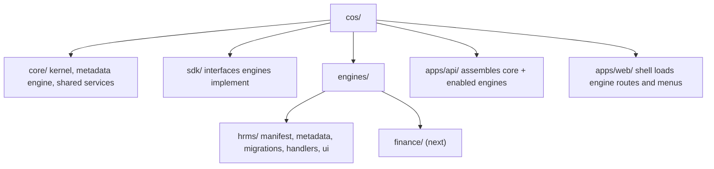


## Architecture decisions to record

These decisions shape everything above; each needs its own record and approval.

| Ref | Decision | Status |
| --- | --- | --- |
| ADR-01 | Modular monolith with COS Core and plug-in engines | Proposed |
| ADR-02 | The engine is the plug-in and entitlement unit | Proposed |
| ADR-03 | Typed tables for core fields; typed value rows for company fields | Proposed |
| ADR-04 | All metadata is versioned and pinned by transactions | Proposed |
| ADR-05 | Product metadata in git, entity configuration in the database | Proposed |
| ADR-06 | No executable code or raw SQL in metadata | Proposed (matches DRAFT-BE-R10) |
| ADR-07 | Transactional outbox for all cross-engine and external effects | Proposed |
| ADR-08 | Generic metadata API plus engine custom endpoints | Proposed |


## Technology stack

| Layer | Choice | State | Evidence | Notes |
| --- | --- | --- | --- | --- |
| Backend language/runtime | Java 21 (LTS) | In use at baseline | apps/api/pom.xml java.version 21 | Keep LTS; upgrade through a reviewed decision. |
| Backend framework | Spring Boot 4.1 (Web MVC, Validation, Security, OAuth2 Resource Server) | In use at baseline | spring-boot-starter-parent 4.1.1 | Add Spring Modulith (or ArchUnit) for module boundary checks - Proposed. |
| Data access | Spring JDBC with explicit parameterised SQL in repositories | In use at baseline | spring-boot-starter-jdbc | Matches DRAFT-BE-R04. No ORM required; jOOQ is an optional later proposal. |
| Database | PostgreSQL | In use at baseline | postgresql driver; local profile | Typed tables for core entities, JSONB for configurable extra fields and metadata payloads, schema per engine. |
| Schema migration | Flyway, forward-only versioned migrations | In use at baseline | db/migration V1..V4 | Matches DRAFT-BE-R16; separate migration identity per developer guide. |
| Frontend | Next.js 16 + React 19 + TypeScript | In use at baseline | apps/web/package.json | Kebab-case file naming per Naming 0.2.3. |
| Metadata-driven UI | Shared form/grid renderer driven by pinned config versions; JSON Schema shared by server and browser validation | Proposed |  | Candidate libraries: react-hook-form + Zod or JSON Forms; TanStack Table for grids. Selection pending. |
| Rules | Declarative rules as reviewed metadata (no executable code, no arbitrary SQL); complex logic in typed Java domain handlers | Proposed | DRAFT-BE-R10 | Candidate expression language: CEL. Selection pending. |
| Workflow/approvals | In-application state machine with persisted transitions and authority matrix | Proposed | DRAFT-BE-R07 | Consider Temporal/Camunda only if long-running multi-party workflows exceed this. |
| Background work | Same backend artifact started in worker role; DB-backed job claiming and transactional outbox | Proposed (outbox table exists at baseline) | DRAFT-BE-R12, DRAFT-BE-R13; integration.outbox | Message broker (RabbitMQ/Kafka) only after measured need. |
| Identity | OIDC/OAuth2 tokens validated by the API; external IdP for workforce sign-in | Partly in use (resource server); IdP selection Proposed | spring-boot-starter-security-oauth2-resource-server | Candidates: Google Workspace SSO, Keycloak. Local password accounts at baseline need a migration decision. |
| File/document storage | Private object storage for raw imports, exports and large documents; DB keeps metadata and hashes | Proposed (baseline stores encrypted documents in PostgreSQL) | EMPRegister README | Decision pending: keep in DB vs move to object storage. |
| Reporting | Governed PostgreSQL views/materialized views as virtual marts; authorized report service; dashboard tool optional | Proposed (VIRTUAL-MART-01 direction recorded) | architecture/virtual-marts.yaml | Candidate BI tools: Metabase, Apache Superset. |
| Search | PostgreSQL full-text and trigram indexes | Proposed |  | Dedicated search engine only after measured need. |
| Testing | JUnit + Spring test slices; Playwright end-to-end with axe accessibility checks | In use at baseline | package.json, playwright configs | Add Testcontainers PostgreSQL for integration tests - Proposed. |
| Packaging/hosting | Container images; managed PostgreSQL; managed container runtime | Proposed |  | Candidate: Google Cloud Run + Cloud SQL (fits Google Workspace usage). Provider decision pending. |
| Observability | Structured JSON logs with correlation/run IDs, OpenTelemetry traces and metrics | Proposed | DRAFT-BE-R15 | Backend to be chosen with hosting. |
| CI/CD | GitHub Actions: build, tests, migrations dry-run, image build, environment promotion | Proposed (governance CI exists) | .github/workflows/governance.yml | Production deploy requires explicit approval. |

## Tenancy

Single platform deployment serving multiple organisations; every business row carries scope_id resolved from the authenticated entity context.

Hierarchy: Platform → Organisation / group → Legal entity → Brand → Outlet / kitchen → Department / unit

- Server resolves scope from the authenticated principal and selected authorized entity; clients never supply actor or approver identity (DRAFT-BE-R17).
- Repositories always filter by scope; composite (scope_id, id) foreign keys keep relations inside one scope (shared-data-design common constraints).
- PostgreSQL row-level security as a second defence layer - Proposed.
- Entitlements (config.entitlement) gate suites/engines per organisation.

Open questions:

- Is sys_emp_id unique per organisation or per legal entity? (emp-data-design pending item)
- Do franchises run as separate organisations or as entities within the group?
- Which masters are shared across brands (items, vendors) and which are brand-specific?

## Metadata runtime

Versioned metadata + configuration -> shared service runtime -> typed domain handler -> domain-owned persistence (metadata-driven-component-standard).

| Config state | Meaning |
| --- | --- |
| Draft | Editable by entity administrator; validated against JSON Schema and reviewed field types |
| Review | Preview of generated screen/import/report; impact on existing records shown |
| Active | Immutable version; exactly one active version per object and scope |
| Retired | Kept for history; records pinned to it remain readable |

- Every transaction, draft and import run stores the config version it used (DRAFT-BE-R11).
- Active versions are immutable; changes create a new version and go through confirmation (config.confirmation).
- Runtime caches config by (scope, object, version); activation publishes an outbox event that invalidates caches.
- Rollback means re-activating an earlier version, never editing history.
- Metadata may select reviewed field types, validators, layouts, uniqueness fields, permissions, mappings and report columns; it may not contain executable code, arbitrary SQL or new storage structures (DRAFT-BE-R10).
- Needs beyond metadata (new algorithms, new tables) go through code review and Flyway migration.

| Data | Placement |
| --- | --- |
| Core business fields (identity, keys, money, dates, status) | Typed columns in the owning engine schema |
| Entity-configured additional fields | Typed values referencing field-definition versions (e.g. emp.emp_field_value) or JSONB validated by schema |
| Metadata definitions | config schema tables with JSONB payload plus typed key columns |
| History and audit | audit.change_event and per-domain history, written in the same transaction |

## Runtime components

| Component | Technology | Responsibility | Engines |
| --- | --- | --- | --- |
| Web client | Next.js | Shell, navigation, metadata-rendered forms/grids, previews and confirmations | Application Services |
| API gateway layer | Spring MVC controllers | Authentication, transport validation, versioned /api/v1 routes (DRAFT-BE-R02) | API Management |
| Platform services | Spring module | ConfigService, UniqueKeyService, AccessService, SubscriptionService, PreferenceService, ErrorService | Configuration, Security, Identity & Access |
| Integration services | Spring module | ImportService, MappingService, SheetSyncService, email extraction, source adapters | Integration suite |
| Reporting services | Spring module + PostgreSQL views | ReportService, MartService, exports | BI & Reporting, KPI & Dashboards |
| Domain modules | Spring modules with handlers | Engine-specific invariants and algorithms (HRMS first; Finance/Ownly journals, Procurement, Inventory next) | One per engine |
| Worker | Same artifact, worker role | Import jobs, sheet syncs, outbox delivery, scheduled jobs; claims work once and rechecks authority (DRAFT-BE-R12) | Data Integration, Event Integration |
| Database | PostgreSQL | Schemas per engine plus auth, config, audit, integration, report | Database Services |
| Object storage | Private bucket | Raw source files, exports, large documents | File & Document Services |
| Identity provider | OIDC IdP | Workforce sign-in, MFA | Identity & Access |

## Deployment

| Environment | Purpose |
| --- | --- |
| local | Developer machine; embedded/local PostgreSQL as in EMPRegister scripts; synthetic data only |
| test | CI-created; ephemeral database; automated tests |
| staging | Production-like; masked or synthetic data; release candidate verification |
| production | Real data; deploy only after explicit approval and recorded evidence (DRAFT-BE-R18) |

| Unit | Behaviour |
| --- | --- |
| web | Next.js container, stateless, horizontally scalable |
| api | Backend container in api role, stateless, horizontally scalable |
| worker | Same backend image in worker role, scaled by queue depth |
| database | Managed PostgreSQL with automated backups and point-in-time recovery |
| storage | Private object storage bucket per environment |

- Images are immutable and promoted across environments; configuration and secrets come from the environment's secret manager.
- Migrations run as a separate step with a migration identity before the new api/worker version starts.
- Backups follow BACKUP-TIME-01 naming for exported backup files.

Hosting candidate: Google Cloud: Cloud Run (web, api, worker), Cloud SQL for PostgreSQL, Cloud Storage, Secret Manager, Cloud Logging. Pending decision.

## Integration patterns

| Pattern | Used for | Flow | Idempotency |
| --- | --- | --- | --- |
| File import | Aggregator payouts (Ownly), bulk employee upload, Attendo exports | Upload/source -> preserve raw file -> profile parse -> stage rows (integration.import_row) -> mapping -> preview -> confirmed execute -> domain write + audit -> errors traceable | integration.processed_source hash per source version |
| API pull | Petpooja, Zoho Books, Razorpay, Attendo (once verified) | Scheduled worker job -> adapter with approved connection -> stage -> same mapping/validation path as file import | Provider IDs mapped in id-map tables; sync_run checkpoints |
| API push | Zoho journals, payouts | Domain event -> outbox -> worker -> external call with idempotency key -> record response; unknown responses reconciled before retry | Payload hash plus external reference |
| Webhook in | Payment/settlement notifications | Verify signature -> store raw event -> process asynchronously | Provider event ID |
| Google Sheet sync | Interim working sheets and outputs | Preview exact ranges -> explicit append/clear confirmation -> write -> read back counts | sync_run bound to confirmation |

## Security

- OIDC sign-in with MFA for administrators; API validates tokens and resolves principal server-side.
- Authorization layers: entitlement -> access group -> hierarchy scope -> record -> field (AccessService).
- Encrypt sensitive fields (identity, bank, documents) at application level; keys in a secret manager; baseline already encrypts profile payloads and documents.
- Secrets never in GitHub, preferences or metadata; external connections referenced by approved connection IDs.
- Every mutation writes audit and history in the same transaction; logs redact secrets and documents.
- Exports and Sheet outputs pass the same authorization as screens; masked values stay masked.

## Non-functional candidates

| Area | Candidate | Status |
| --- | --- | --- |
| Scale (initial) | Up to 50 outlets, 2,000 employees, 300 concurrent users, 100k sales rows per day | Candidate - confirm with business |
| Interactive latency | p95 under 500 ms for reads and single-record saves; imports asynchronous with progress | Candidate |
| Availability | 99.5% monthly during business hours for production | Candidate |
| Backup and recovery | RPO 15 minutes (point-in-time recovery); RTO 4 hours; restore drill each quarter | Candidate |
| Import size | Files up to 50,000 rows per run; limits configurable (DRAFT-BE-R14) | Candidate |
| Audit retention | Financial and payroll history retained at least 8 years; confirm statutory requirement | Candidate - legal review |
| Data residency | Primary region in India | Candidate |

## Observability

- Correlation ID per request and run ID per job carried through logs, outbox and external calls.
- Metrics: request latency, error codes, import rows by disposition, outbox lag, sync failures.
- Alerts for failed jobs, outbox lag and authentication anomalies to authorized recipients only.

## Worked example: Employee Registration (emp_reg)

1. Entity administrator activates field, form and uniqueness config versions for the entity.
2. Web client loads the pinned form version and renders fields; required/help/error text come from config.
3. API validates transport DTO, AccessService checks write scope and field access.
4. UniqueKeyService validates the complete configured key and claims it transactionally.
5. Employee handler writes emp tables, field values, audit event and outbox event in one transaction.
6. Worker delivers outbox events (e.g. Sheet output, notifications) after commit.
7. Employee directory mart (vw_emp_directory) serves reports with the same access rules.

## Diagrams

### System context

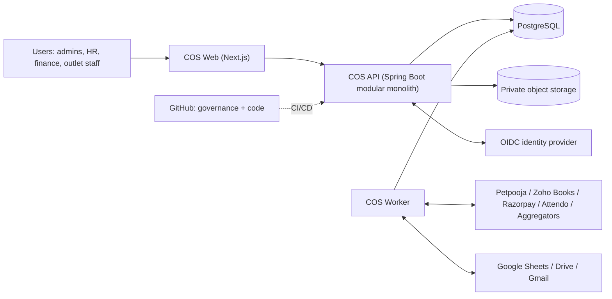

### Metadata-driven runtime layers

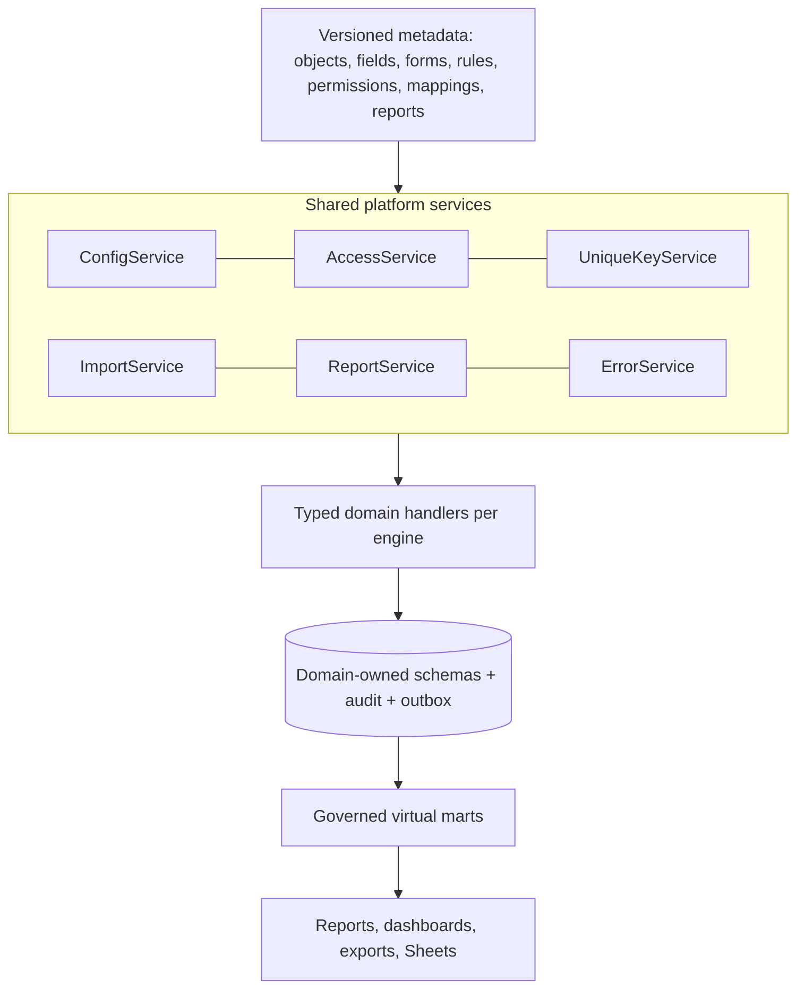

### Deployment view (candidate)

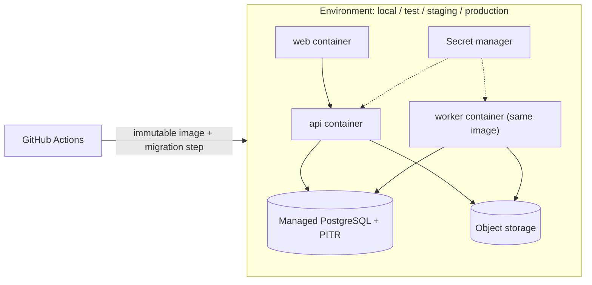

### Configured record save

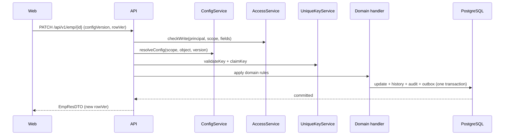

### File import with preview

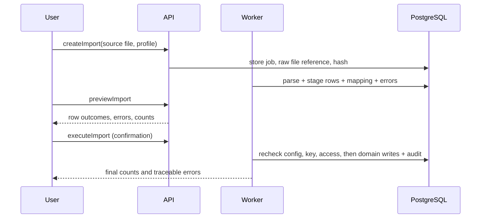

## Pending decisions

| Ref | Topic |
| --- | --- |
| SD-P01 | Approve modular monolith as the COS architecture style |
| SD-P02 | Record the baseline stack (Java 21, Spring Boot 4.1, JDBC, Flyway, PostgreSQL, Next.js/React/TypeScript) as Technology Stack Standard rules |
| SD-P03 | Hosting provider and region |
| SD-P04 | Identity provider and migration of baseline local password accounts |
| SD-P05 | Tenancy boundaries: organisation vs legal entity vs franchise; sys_emp_id uniqueness scope |
| SD-P06 | Document storage: PostgreSQL (baseline) vs private object storage |
| SD-P07 | Rule expression language and metadata UI renderer library |
| SD-P08 | Confirm non-functional targets (scale, latency, availability, RPO/RTO, retention, residency) |
| SD-P09 | Verify external API entitlements: Petpooja, Zoho Books, Razorpay, Attendo |
| SD-P10 | Access precedence across multiple groups and parent-to-child inheritance |
| SD-P11 | Company-field storage: typed value table (proposed) or JSONB with generated indexes |
| SD-P12 | Engine manifest and metadata package format (YAML schema) and where engine packages live |
| SD-P13 | COS Studio scope for the first release |
| SD-P14 | Approve ADR-01 to ADR-08 |

[Canonical system design](../architecture/system-design.yaml) · [Metadata standard](../architecture/metadata-driven-component-standard.yaml) · [Developer guide](developer-guide.md) · [Virtual marts](virtual-marts.md)
