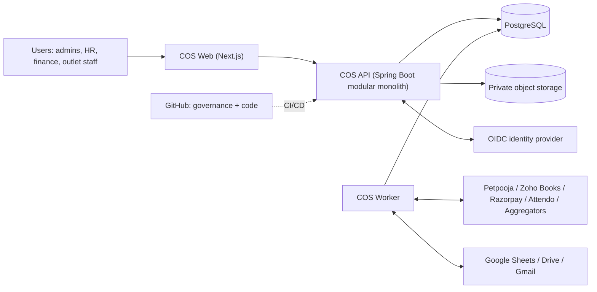
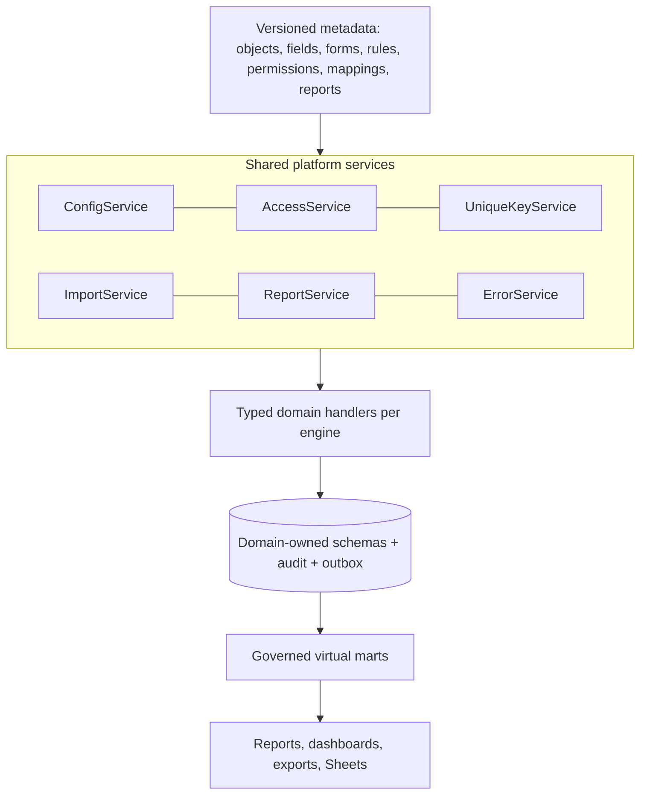
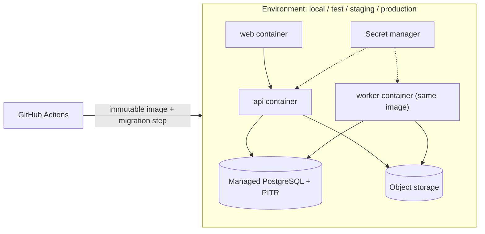
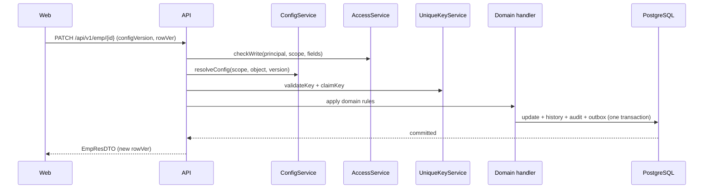

# System design

> Generated from maintained definitions. Do not edit this page directly.
> Governance 0.3.8; naming 0.2.3; application evidence b2b156c44ba7744bf6cb81c19eb3a05d8633fdba.
> Draft catalogue. Approval, implementation, verification and publication are separate.

[Home](README.md) · [Relational tree](tree.md) · [Architecture](architecture.md) · [Standards](standards.md) · [Naming](naming.md) · [Features](features.md) · [Design](design.md) · [Implementation](implementation.md) · [Decisions](decisions.md)

| Property | Value |
| --- | --- |
| Reference | SYS-DESIGN-01 |
| Version | 0.1.0 |
| Stage | Draft |
| Approval | Pending |
| Implementation | Partially reflected by the EMPRegister baseline for Employee Management only; COS-wide runtime not implemented |
| Verification | Source inspection of the pinned application baseline only; no load, security or deployment test executed |
| Publication | Unpublished |

Runtime system design for the whole CulinaOS platform: architecture style, technology stack, tenancy, metadata runtime, components, deployment, integration, data, security, non-functional targets and diagrams. Business hierarchy stays in architecture/objects.yaml; logical tables stay in the data-design files.

**Not affected:** Does not approve any Pending standard, rule, shortcode or decision. Does not adopt the Technology Stack Standard; stack rows marked Proposed need explicit approval. No application code, schema, deployment, cloud account or connector is created or changed. Candidate non-functional targets are proposals until the business confirms them.

## Context

CulinaOS (COS) is a metadata-driven operating platform for a multi-brand restaurant and cloud-kitchen business (initial company: MHL). One platform hosts 9 suites / 47 engines; each engine is delivered as configuration over shared runtime services plus a small amount of domain code.

| Actor | Role |
| --- | --- |
| Platform administrator | Manages tenants, entitlements, platform configuration and releases |
| Entity administrator | Configures fields, forms, uniqueness keys, access groups and imports for a company/brand/outlet |
| Operational user | HR, finance, purchase, kitchen and outlet staff using generated screens |
| Reviewer / approver | Approves operation-specific changes per the authority matrix |
| Developer | Builds domain handlers and shared services from Published baselines |
| AI assistant | Reads governed definitions; never writes without explicit confirmation (GITHUB-CONFIRM-01, AI-CREATE-CONFIRM-01) |

| External system | Use | State |
| --- | --- | --- |
| Petpooja | POS sales, raw materials, recipes, operational inventory | API scope UNVERIFIED |
| Zoho Books | Invoice scanning, bills, vendor payables, accounting masters, journals | Organisation configuration pending |
| Razorpay | Payments, settlements, payouts and/or payroll | Exact product and scope pending |
| Attendo | Attendance source | API entitlement unverified |
| Aggregators (Ownly and others) | Payout and order files | File-based; Ownly rules drafted |
| Google Workspace | Sheets input/output, Drive files, Gmail extraction, optional SSO | Sheets sync not implemented |
| GitHub | Governance definitions, code, CI | Live operational data excluded |

## Architecture style

Modular monolith with metadata-driven shared services; one backend codebase and deployable, internally divided by suite/engine modules with enforced boundaries.

- Small team (four named working users) cannot operate 47 independently deployed services.
- Shared services (config, uniqueness, access, import, report, audit) are used by every engine and need one transaction boundary with domain writes (DRAFT-BE-R06).
- Module boundaries keep a later extraction possible for a suite that proves different scale, release cadence or ownership.

### Module rules

- One Java module/package root per engine; shared services live in a platform module and never depend on domain modules.
- Engines call each other only through published module APIs or outbox events, never through another engine's tables.
- Each engine owns its database schema; cross-engine reads use APIs, events or governed virtual marts.
- Boundary rules are checked in CI (module dependency tests) once the code structure is approved.

Extract a module into its own service only with a recorded decision showing independent scaling, isolation, compliance or team-ownership need.

| Alternative | Outcome |
| --- | --- |
| Microservices per engine | Rejected for now: operational cost and distributed transactions outweigh benefits at current scale |
| Low-code platform / spreadsheet-only | Rejected: cannot meet uniqueness, audit, permission and integration guarantees already approved |
| Fully generic EAV data model | Rejected: core entities need real typed tables; JSONB only for configurable extra fields |

## Technology stack

| Layer | Choice | State | Evidence | Notes |
| --- | --- | --- | --- | --- |
| Backend language/runtime | Java 21 (LTS) | In use at baseline | apps/api/pom.xml java.version 21 | Keep LTS; upgrade through a reviewed decision. |
| Backend framework | Spring Boot 4.1 (Web MVC, Validation, Security, OAuth2 Resource Server) | In use at baseline | spring-boot-starter-parent 4.1.1 | Add Spring Modulith (or ArchUnit) for module boundary checks - Proposed. |
| Data access | Spring JDBC with explicit parameterised SQL in repositories | In use at baseline | spring-boot-starter-jdbc | Matches DRAFT-BE-R04. No ORM required; jOOQ is an optional later proposal. |
| Database | PostgreSQL | In use at baseline | postgresql driver; local profile | Typed tables for core entities, JSONB for configurable extra fields and metadata payloads, schema per engine. |
| Schema migration | Flyway, forward-only versioned migrations | In use at baseline | db/migration V1..V4 | Matches DRAFT-BE-R16; separate migration identity per developer guide. |
| Frontend | Next.js 16 + React 19 + TypeScript | In use at baseline | apps/web/package.json | Kebab-case file naming per Naming 0.2.3. |
| Metadata-driven UI | Shared form/grid renderer driven by pinned config versions; JSON Schema shared by server and browser validation | Proposed |  | Candidate libraries: react-hook-form + Zod or JSON Forms; TanStack Table for grids. Selection pending. |
| Rules | Declarative rules as reviewed metadata (no executable code, no arbitrary SQL); complex logic in typed Java domain handlers | Proposed | DRAFT-BE-R10 | Candidate expression language: CEL. Selection pending. |
| Workflow/approvals | In-application state machine with persisted transitions and authority matrix | Proposed | DRAFT-BE-R07 | Consider Temporal/Camunda only if long-running multi-party workflows exceed this. |
| Background work | Same backend artifact started in worker role; DB-backed job claiming and transactional outbox | Proposed (outbox table exists at baseline) | DRAFT-BE-R12, DRAFT-BE-R13; integration.outbox | Message broker (RabbitMQ/Kafka) only after measured need. |
| Identity | OIDC/OAuth2 tokens validated by the API; external IdP for workforce sign-in | Partly in use (resource server); IdP selection Proposed | spring-boot-starter-security-oauth2-resource-server | Candidates: Google Workspace SSO, Keycloak. Local password accounts at baseline need a migration decision. |
| File/document storage | Private object storage for raw imports, exports and large documents; DB keeps metadata and hashes | Proposed (baseline stores encrypted documents in PostgreSQL) | EMPRegister README | Decision pending: keep in DB vs move to object storage. |
| Reporting | Governed PostgreSQL views/materialized views as virtual marts; authorized report service; dashboard tool optional | Proposed (VIRTUAL-MART-01 direction recorded) | architecture/virtual-marts.yaml | Candidate BI tools: Metabase, Apache Superset. |
| Search | PostgreSQL full-text and trigram indexes | Proposed |  | Dedicated search engine only after measured need. |
| Testing | JUnit + Spring test slices; Playwright end-to-end with axe accessibility checks | In use at baseline | package.json, playwright configs | Add Testcontainers PostgreSQL for integration tests - Proposed. |
| Packaging/hosting | Container images; managed PostgreSQL; managed container runtime | Proposed |  | Candidate: Google Cloud Run + Cloud SQL (fits Google Workspace usage). Provider decision pending. |
| Observability | Structured JSON logs with correlation/run IDs, OpenTelemetry traces and metrics | Proposed | DRAFT-BE-R15 | Backend to be chosen with hosting. |
| CI/CD | GitHub Actions: build, tests, migrations dry-run, image build, environment promotion | Proposed (governance CI exists) | .github/workflows/governance.yml | Production deploy requires explicit approval. |

## Tenancy

Single platform deployment serving multiple organisations; every business row carries scope_id resolved from the authenticated entity context.

Hierarchy: Platform → Organisation / group → Legal entity → Brand → Outlet / kitchen → Department / unit

- Server resolves scope from the authenticated principal and selected authorized entity; clients never supply actor or approver identity (DRAFT-BE-R17).
- Repositories always filter by scope; composite (scope_id, id) foreign keys keep relations inside one scope (shared-data-design common constraints).
- PostgreSQL row-level security as a second defence layer - Proposed.
- Entitlements (config.entitlement) gate suites/engines per organisation.

Open questions:

- Is sys_emp_id unique per organisation or per legal entity? (emp-data-design pending item)
- Do franchises run as separate organisations or as entities within the group?
- Which masters are shared across brands (items, vendors) and which are brand-specific?

## Metadata runtime

Versioned metadata + configuration -> shared service runtime -> typed domain handler -> domain-owned persistence (metadata-driven-component-standard).

| Config state | Meaning |
| --- | --- |
| Draft | Editable by entity administrator; validated against JSON Schema and reviewed field types |
| Review | Preview of generated screen/import/report; impact on existing records shown |
| Active | Immutable version; exactly one active version per object and scope |
| Retired | Kept for history; records pinned to it remain readable |

- Every transaction, draft and import run stores the config version it used (DRAFT-BE-R11).
- Active versions are immutable; changes create a new version and go through confirmation (config.confirmation).
- Runtime caches config by (scope, object, version); activation publishes an outbox event that invalidates caches.
- Rollback means re-activating an earlier version, never editing history.
- Metadata may select reviewed field types, validators, layouts, uniqueness fields, permissions, mappings and report columns; it may not contain executable code, arbitrary SQL or new storage structures (DRAFT-BE-R10).
- Needs beyond metadata (new algorithms, new tables) go through code review and Flyway migration.

| Data | Placement |
| --- | --- |
| Core business fields (identity, keys, money, dates, status) | Typed columns in the owning engine schema |
| Entity-configured additional fields | Typed values referencing field-definition versions (e.g. emp.emp_field_value) or JSONB validated by schema |
| Metadata definitions | config schema tables with JSONB payload plus typed key columns |
| History and audit | audit.change_event and per-domain history, written in the same transaction |

## Runtime components

| Component | Technology | Responsibility | Engines |
| --- | --- | --- | --- |
| Web client | Next.js | Shell, navigation, metadata-rendered forms/grids, previews and confirmations | Application Services |
| API gateway layer | Spring MVC controllers | Authentication, transport validation, versioned /api/v1 routes (DRAFT-BE-R02) | API Management |
| Platform services | Spring module | ConfigService, UniqueKeyService, AccessService, SubscriptionService, PreferenceService, ErrorService | Configuration, Security, Identity & Access |
| Integration services | Spring module | ImportService, MappingService, SheetSyncService, email extraction, source adapters | Integration suite |
| Reporting services | Spring module + PostgreSQL views | ReportService, MartService, exports | BI & Reporting, KPI & Dashboards |
| Domain modules | Spring modules with handlers | Engine-specific invariants and algorithms (HRMS first; Finance/Ownly journals, Procurement, Inventory next) | One per engine |
| Worker | Same artifact, worker role | Import jobs, sheet syncs, outbox delivery, scheduled jobs; claims work once and rechecks authority (DRAFT-BE-R12) | Data Integration, Event Integration |
| Database | PostgreSQL | Schemas per engine plus auth, config, audit, integration, report | Database Services |
| Object storage | Private bucket | Raw source files, exports, large documents | File & Document Services |
| Identity provider | OIDC IdP | Workforce sign-in, MFA | Identity & Access |

## Deployment

| Environment | Purpose |
| --- | --- |
| local | Developer machine; embedded/local PostgreSQL as in EMPRegister scripts; synthetic data only |
| test | CI-created; ephemeral database; automated tests |
| staging | Production-like; masked or synthetic data; release candidate verification |
| production | Real data; deploy only after explicit approval and recorded evidence (DRAFT-BE-R18) |

| Unit | Behaviour |
| --- | --- |
| web | Next.js container, stateless, horizontally scalable |
| api | Backend container in api role, stateless, horizontally scalable |
| worker | Same backend image in worker role, scaled by queue depth |
| database | Managed PostgreSQL with automated backups and point-in-time recovery |
| storage | Private object storage bucket per environment |

- Images are immutable and promoted across environments; configuration and secrets come from the environment's secret manager.
- Migrations run as a separate step with a migration identity before the new api/worker version starts.
- Backups follow BACKUP-TIME-01 naming for exported backup files.

Hosting candidate: Google Cloud: Cloud Run (web, api, worker), Cloud SQL for PostgreSQL, Cloud Storage, Secret Manager, Cloud Logging. Pending decision.

## Integration patterns

| Pattern | Used for | Flow | Idempotency |
| --- | --- | --- | --- |
| File import | Aggregator payouts (Ownly), bulk employee upload, Attendo exports | Upload/source -> preserve raw file -> profile parse -> stage rows (integration.import_row) -> mapping -> preview -> confirmed execute -> domain write + audit -> errors traceable | integration.processed_source hash per source version |
| API pull | Petpooja, Zoho Books, Razorpay, Attendo (once verified) | Scheduled worker job -> adapter with approved connection -> stage -> same mapping/validation path as file import | Provider IDs mapped in id-map tables; sync_run checkpoints |
| API push | Zoho journals, payouts | Domain event -> outbox -> worker -> external call with idempotency key -> record response; unknown responses reconciled before retry | Payload hash plus external reference |
| Webhook in | Payment/settlement notifications | Verify signature -> store raw event -> process asynchronously | Provider event ID |
| Google Sheet sync | Interim working sheets and outputs | Preview exact ranges -> explicit append/clear confirmation -> write -> read back counts | sync_run bound to confirmation |

## Security

- OIDC sign-in with MFA for administrators; API validates tokens and resolves principal server-side.
- Authorization layers: entitlement -> access group -> hierarchy scope -> record -> field (AccessService).
- Encrypt sensitive fields (identity, bank, documents) at application level; keys in a secret manager; baseline already encrypts profile payloads and documents.
- Secrets never in GitHub, preferences or metadata; external connections referenced by approved connection IDs.
- Every mutation writes audit and history in the same transaction; logs redact secrets and documents.
- Exports and Sheet outputs pass the same authorization as screens; masked values stay masked.

## Non-functional candidates

| Area | Candidate | Status |
| --- | --- | --- |
| Scale (initial) | Up to 50 outlets, 2,000 employees, 300 concurrent users, 100k sales rows per day | Candidate - confirm with business |
| Interactive latency | p95 under 500 ms for reads and single-record saves; imports asynchronous with progress | Candidate |
| Availability | 99.5% monthly during business hours for production | Candidate |
| Backup and recovery | RPO 15 minutes (point-in-time recovery); RTO 4 hours; restore drill each quarter | Candidate |
| Import size | Files up to 50,000 rows per run; limits configurable (DRAFT-BE-R14) | Candidate |
| Audit retention | Financial and payroll history retained at least 8 years; confirm statutory requirement | Candidate - legal review |
| Data residency | Primary region in India | Candidate |

## Observability

- Correlation ID per request and run ID per job carried through logs, outbox and external calls.
- Metrics: request latency, error codes, import rows by disposition, outbox lag, sync failures.
- Alerts for failed jobs, outbox lag and authentication anomalies to authorized recipients only.

## Worked example: Employee Registration (emp_reg)

1. Entity administrator activates field, form and uniqueness config versions for the entity.
2. Web client loads the pinned form version and renders fields; required/help/error text come from config.
3. API validates transport DTO, AccessService checks write scope and field access.
4. UniqueKeyService validates the complete configured key and claims it transactionally.
5. Employee handler writes emp tables, field values, audit event and outbox event in one transaction.
6. Worker delivers outbox events (e.g. Sheet output, notifications) after commit.
7. Employee directory mart (vw_emp_directory) serves reports with the same access rules.

## Diagrams

### System context



### Metadata-driven runtime layers



### Deployment view (candidate)



### Configured record save



### File import with preview

```mermaid
sequenceDiagram
  participant U as User
  participant API as API
  participant W as Worker
  participant DB as PostgreSQL
  U->>API: createImport(source file, profile)
  API->>DB: store job, raw file reference, hash
  W->>DB: parse + stage rows + mapping + errors
  U->>API: previewImport
  API-->>U: row outcomes, errors, counts
  U->>API: executeImport (confirmation)
  W->>DB: recheck config/key/access; domain writes + audit
  W-->>U: final counts and traceable errors
```

## Pending decisions

| Ref | Topic |
| --- | --- |
| SD-P01 | Approve modular monolith as the COS architecture style |
| SD-P02 | Record the baseline stack (Java 21, Spring Boot 4.1, JDBC, Flyway, PostgreSQL, Next.js/React/TypeScript) as Technology Stack Standard rules |
| SD-P03 | Hosting provider and region |
| SD-P04 | Identity provider and migration of baseline local password accounts |
| SD-P05 | Tenancy boundaries: organisation vs legal entity vs franchise; sys_emp_id uniqueness scope |
| SD-P06 | Document storage: PostgreSQL (baseline) vs private object storage |
| SD-P07 | Rule expression language and metadata UI renderer library |
| SD-P08 | Confirm non-functional targets (scale, latency, availability, RPO/RTO, retention, residency) |
| SD-P09 | Verify external API entitlements: Petpooja, Zoho Books, Razorpay, Attendo |

[Canonical system design](../architecture/system-design.yaml) · [Metadata standard](../architecture/metadata-driven-component-standard.yaml) · [Developer guide](developer-guide.md) · [Virtual marts](virtual-marts.md)
