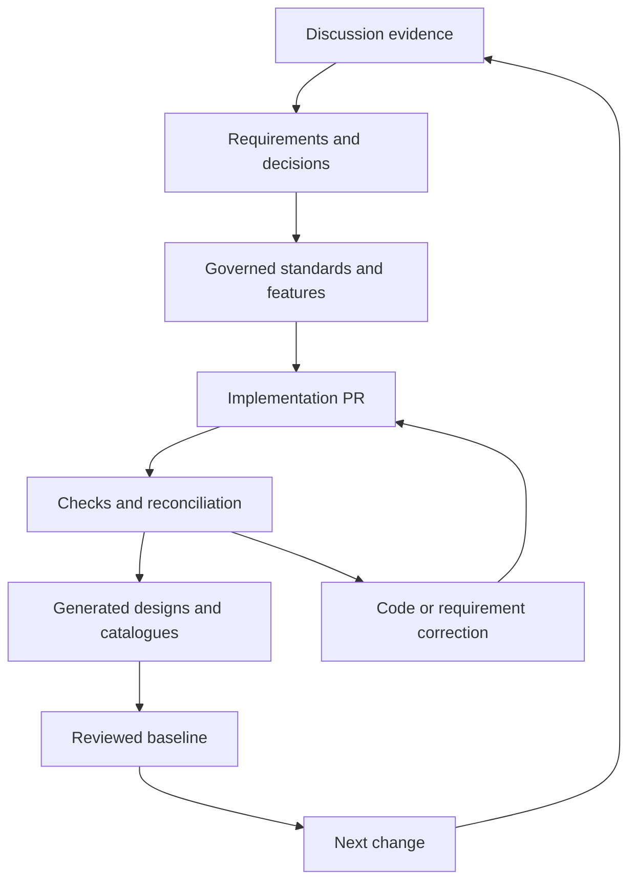

# Discussion-to-delivery flow
Proposed operating flow; only this repository scaffold and preservation import are delivered here.

## Current migration
1. Preserve source snapshots and discussion provenance.
2. Consolidate maintained standards, architecture, features and decisions.
3. Generate implementation inventories instead of manually duplicating them.
4. Reconcile missing business field/screen meanings and requirement/code differences.
5. Review source versions, references, history and representative outputs.
6. Explicitly declare authoritative-source cutover.
7. Retire redundant active registers; preserve controlled history.
8. Decide deletion/retention separately. No deletion happens in this draft.

## Authoritative responsibilities
Governance owns rules and intended architecture. Application source owns actual classes/methods/repos. Contracts own API/DTO definitions under the selected strategy. Migrations own physical schema changes. Operational masters remain in application databases. Generated outputs pin source versions and code commit.
