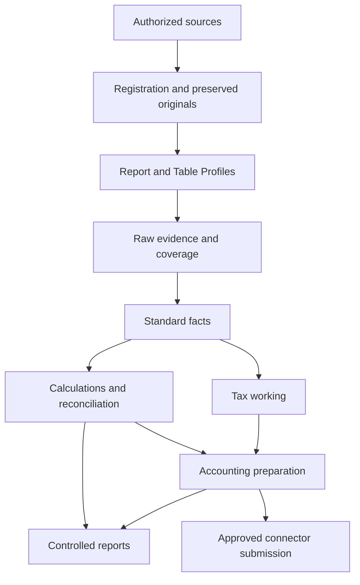

# Finance Engine architecture

Stage: Draft | Working user: Ashish | Recorded: 29-Oct-2026

These are proposed capability boundaries, not newly allocated permanent COS objects. Placement within the governed suite/engine inventory requires architecture alignment.

| Component | Input | Output / responsibility |
|---|---|---|
| Source Intake | Authorized connections and intake rules | Received source references |
| File Registration | Source bytes/revision evidence | Checksum, identity, revisions and duplicate-file disposition |
| Profile Resolution | Registered file and approved profiles | Versioned extraction plan |
| Table Extraction | Extraction plan and source | Raw records, coordinates, coverage and errors |
| Standardization | Raw records, field/master mappings | Validated facts at defined grains |
| Business Calculation | Facts and effective rules | Traceable calculated results |
| Reconciliation | Compatible facts and match profiles | Allocations, differences and residual balances |
| Tax Working | Classified source facts and tax configuration | GST/TDS working |
| Accounting Preparation | Accepted facts and accounting profiles | Draft balanced documents |
| Accounting Connector | Approved payload and organization scope | Attempts, external IDs and readback |
| Report Generator | Controlled views and output profiles | Reports with coverage and run context |
| Review / Audit | Exceptions and authorized decisions | Version-specific approval and history |

Reuse suitable COS identity, access, file, configuration and notification services after verifying their contracts. Notification delivery and scheduling are not configured by this documentation.

Review, audit, configuration snapshots and server-side authorization apply across all components. Staging remains separate from accepted facts. Long-running operations return durable run references; accepted batches commit transactionally where the chosen technology supports the required guarantee.
