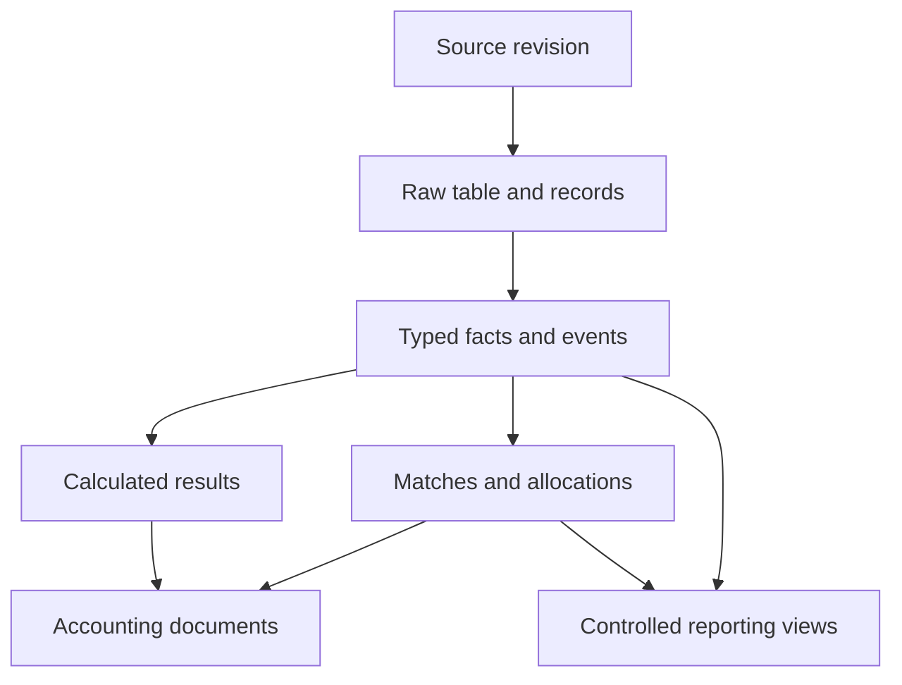

# Logical data model

Stage: Draft | Working user: Ashish | Recorded: 29-Oct-2026

Logical contracts only: no DDL, deployed database or technology adoption is asserted.

| Table/group | Grain / purpose |
|---|---|
| source_file | Registered source revision |
| processing_run / configuration_snapshot | Attempt and immutable processor/configuration baseline |
| extracted_table | Detected table occurrence |
| raw_record / raw_value | Original record/value with header occurrence and coordinates |
| order_fact / order_event | Canonical order identity and individual refund/correction/cancellation events |
| payment_transaction | Provider-scoped payment transaction |
| sales_summary_fact | Source-defined date/entity/outlet/channel summary |
| ledger_event | Typed provider/merchant ledger transaction |
| payout_fact / payout_component | Settlement header and individual movements |
| commission_invoice / commission_invoice_line | Supplier document and billed lines |
| bank_transaction | Imported actual bank transaction |
| tax_component | Classified tax observation linked to originating evidence |
| calculation_result | Rule-version result with input references |
| reconciliation_match / match_allocation | Match decision and allocated amount |
| accounting_document / accounting_line | Prepared document and entries |
| export_batch / connector_attempt | Payload/version, attempt, response and external reference |
| exception / approval / audit_event | Issues, decisions and append-only evidence |

Money uses fixed-precision decimal with currency; precision and rounding stages require approved contracts. Identifiers and UTRs remain text. Dates preserve source meaning and relevant timezone/business-date interpretation.

Business uniqueness is scoped by provider, entity/merchant and transaction type. Exact keys remain pending verification per profile. Separate source observations from canonical identities and revisions. A changed observation must not silently overwrite an accepted fact.

Every result traces to source revision, table occurrence, raw record/value, mapping/rule version, run and validation. Multi-input results need multiple lineage links. Missing metadata has an explicit reason.

Avoid flat joins of orders, invoice lines, payout components and bank allocations: multiplicity can inflate amounts. Controlled views aggregate at compatible grains before combining measures.

Allocations cannot exceed permitted balances. Accepted batches are atomic; incomplete staging is separately visible. Corrections preserve previous accepted versions and approvals.
